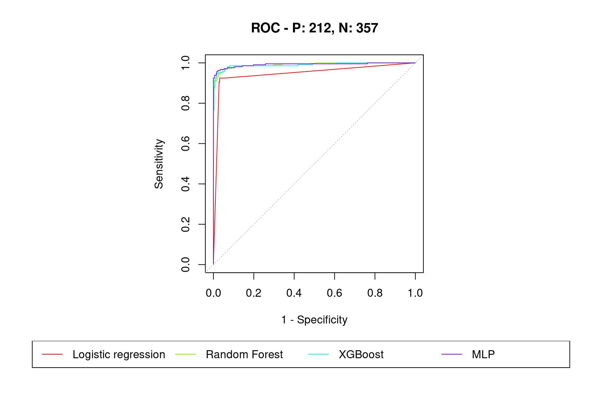
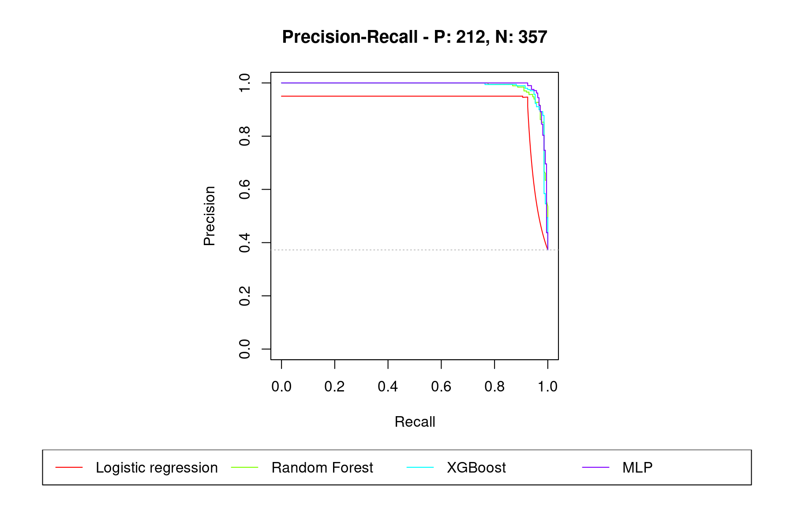

# BreastCancerFNA

**BreastCancerFNA** predicts whether a breast mass is **malignant (M)**
or **benign (B)** from the 30 cell-nucleus features of the [Breast
Cancer Wisconsin (Diagnostic) Data
Set](https://www.kaggle.com/datasets/uciml/breast-cancer-wisconsin-data).
The features describe nuclei in a digitised image of a fine needle
aspirate (FNA): ten measurements (radius, texture, perimeter, area,
smoothness, compactness, concavity, concave points, symmetry, fractal
dimension), each summarised as `_mean`, `_se` (standard error) and
`_worst`.

The package contains the same fitted model as the project’s Shiny
website: <https://xurunlin24.shinyapps.io/bio215-breast-cancer/>

> **Disclaimer:** for teaching and research only. The model is not a
> clinically validated diagnostic tool and must not be used for medical
> decisions.

## Installation

``` r
# install.packages("remotes")
remotes::install_github("Runlin-Xu/BreastCancerFNA")
```

## Usage

The package exports two functions:

| Function | Returns |
|----|----|
| `predict_diagnosis(feature_df, threshold = NULL)` | class labels `"M"` / `"B"` (default threshold 0.19) |
| `predict_malignancy_probability(feature_df)` | probability of malignancy (0-1) |

An example input file with 10 samples is included:

``` r
library(BreastCancerFNA)

example_df <- read.csv(
  system.file("extdata", "example_input.csv", package = "BreastCancerFNA"),
  check.names = FALSE  # keeps column names such as "concave points_mean"
)
dim(example_df)
#> [1] 10 31

predict_diagnosis(example_df)
#>  [1] "M" "B" "B" "B" "M" "M" "B" "B" "B" "M"

data.frame(
  id = example_df$id,
  probability_malignant = round(predict_malignancy_probability(example_df), 4),
  predicted_diagnosis = predict_diagnosis(example_df)
)
#>          id probability_malignant predicted_diagnosis
#> 1    905680                0.9951                   M
#> 2   9113156                0.0146                   B
#> 3    873357                0.0007                   B
#> 4     91805                0.0000                   B
#> 5  87556202                0.9772                   M
#> 6    864729                1.0000                   M
#> 7    892214                0.0018                   B
#> 8  88147202                0.0168                   B
#> 9  88411702                0.0001                   B
#> 10   846381                0.9784                   M
```

Your own `data.frame` needs the 30 feature columns with the original
names; extra columns (such as `id`) are ignored.

## Model and performance

Four models (logistic regression, random forest, XGBoost and a
multilayer perceptron) were compared with **nested cross-validation** (5
outer x 5 inner stratified folds): every sample was tested exactly once
by a model that never saw it, and feature scaling, hyperparameter tuning
and threshold selection used only the training folds. The MLP (`nnet`, 5
hidden units, weight decay 0.001) had the highest area under the
precision-recall curve and was refitted on all 569 samples for this
package. The decision threshold 0.19 maximises the F2 score, which
weights recall twice as much as precision.

Pooled outer-fold (held-out) performance:

| Model                  | AUROC     | AUPRC     | Accuracy | Sensitivity | Specificity |
|------------------------|-----------|-----------|----------|-------------|-------------|
| **MLP (this package)** | **0.992** | **0.991** | 0.942    | 0.962       | 0.930       |
| Random forest          | 0.991     | 0.988     | 0.946    | 0.953       | 0.941       |
| XGBoost                | 0.990     | 0.988     | 0.949    | 0.948       | 0.950       |
| Logistic regression    | 0.947     | 0.921     | 0.951    | 0.925       | 0.966       |



## Citation of the data

W. N. Street, W. H. Wolberg and O. L. Mangasarian. Nuclear feature
extraction for breast tumor diagnosis. *IS&T/SPIE 1993 International
Symposium on Electronic Imaging: Science and Technology*, volume 1905,
pages 861-870, 1993.
